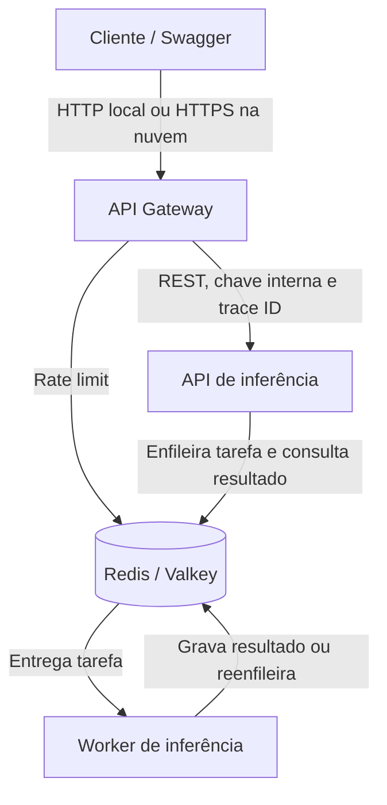

# C3.A2 — Plataforma de IA como Serviço

**Sistemas Distribuídos e Computação em Nuvem · FAESA · 2026/2**  
Professor: Howard Cruz Roatti

Projeto integrador de uma plataforma de inteligência artificial conteinerizada, publicada na nuvem, com comunicação assíncrona, autenticação, tratamento de falhas e rastreamento distribuído.

## 1. Sobre o projeto

A plataforma disponibiliza um serviço de análise de sentimentos em português. O usuário envia um texto, recebe um identificador de tarefa e consulta o resultado posteriormente. O modelo de classificação utiliza scikit-learn e foi reaproveitado das atividades da disciplina. O foco do trabalho é a engenharia distribuída, não a qualidade preditiva do modelo.

## 2. Acesso à plataforma

| Ambiente | Endereço |
|---|---|
| Gateway público (Swagger) | [https://c3a2-gateway.onrender.com/docs](https://c3a2-gateway.onrender.com/docs) |
| Saúde do Gateway público | [https://c3a2-gateway.onrender.com/saude](https://c3a2-gateway.onrender.com/saude) |
| Saúde da inferência na nuvem | [https://c3a2-inferencia.onrender.com/saude](https://c3a2-inferencia.onrender.com/saude) |
| Gateway local (Swagger) | [http://localhost:8000/docs](http://localhost:8000/docs) |

O acesso público utiliza HTTPS fornecido pelo Render. As credenciais de demonstração são fornecidas ao avaliador por um canal privado. Não há senhas ou chaves secretas neste documento.

Os serviços gratuitos podem entrar em suspensão por inatividade. Se a primeira requisição falhar, abra as duas rotas de saúde, aguarde a inicialização e tente novamente.

## 3. Arquitetura



| Componente | Responsabilidade |
|---|---|
| API Gateway | Login, validação JWT, rate limit, encaminhamento REST e circuit breaker. |
| Inferência | Recebimento da entrada, publicação da tarefa e consulta ao resultado. |
| Worker | Consumo da fila, execução do modelo, retentativas e registro do resultado. |
| Redis / Valkey | Fila de tarefas, estados e resultados temporários, dead-letter e contadores de requisições. |

### Fluxo de uma solicitação

1. O cliente obtém um JWT em `POST /login`.
2. O Gateway autentica e verifica o limite de requisições em `POST /predict`.
3. O Gateway encaminha a solicitação à inferência com a chave interna e o identificador de rastreamento.
4. A inferência registra o estado inicial e publica a tarefa no Redis em uma transação, devolvendo HTTP 202 e o identificador da tarefa.
5. O Worker consome a tarefa, executa o modelo e grava o resultado no Redis.
6. O cliente consulta `GET /resultado/{tarefa_id}` pelo Gateway.

Localmente, os quatro componentes são executados em containers separados. No Render, a API de inferência e o Worker compartilham um Web Service, mantendo processos distintos para reduzir o custo da hospedagem.

## 4. Tecnologias

- Python, FastAPI e Uvicorn: implementação dos serviços REST.
- scikit-learn e joblib: modelo de classificação de sentimentos.
- Redis 7 (local) e Valkey (Render): comunicação assíncrona e armazenamento temporário.
- Docker e Docker Compose: empacotamento, rede e orquestração local.
- PyJWT: autenticação com tokens JWT.
- pytest e unittest.mock: testes automatizados.
- Render: hospedagem pública em plano gratuito.

## 5. Estrutura do repositório

```text
sd-2026-2-kit-c3a2/
├── gateway/                 # API Gateway e Dockerfile
├── inferencia/              # API de inferência e Dockerfile
├── worker/                  # Worker, modelo e Dockerfile
├── tests/                   # Testes automatizados
├── deploy/                  # Instruções do kit para publicação
├── docs/
│   └── tradeoffs.md         # Relatório de CAP, custo e latência
├── Dockerfile.render        # Imagem de inferência + worker na nuvem
├── iniciar_render.py        # Inicialização e supervisão dos processos
├── docker-compose.yml       # Orquestração local
├── requirements-test.txt    # Dependências de testes
├── .env.example             # Modelo de configuração sem segredos
├── TAREFAS.md                # Roteiro original de requisitos
└── README.md
```

## 6. Executar localmente do zero

### Pré-requisitos

- Git;
- Docker Desktop (Windows/macOS) ou Docker Engine com Compose v2 (Linux);
- Python 3.12 para gerar as chaves e executar os testes fora dos containers;
- acesso à internet para baixar imagens e dependências na primeira construção.

### 6.1. Clonar o repositório

```bash
git clone https://github.com/soffiamartins/sd-2026-2-kit-c3a2.git
cd sd-2026-2-kit-c3a2
```

### 6.2. Configurar o ambiente

Crie o `.env` a partir do modelo, somente se ainda não existir.

No PowerShell (Windows):

```powershell
Copy-Item .env.example .env
```

No Linux/macOS:

```bash
cp .env.example .env
```

Gere dois segredos independentes:

```bash
python -c "import secrets; print(secrets.token_urlsafe(48))"
python -c "import secrets; print(secrets.token_hex(32))"
```

Edite o `.env`: utilize o primeiro valor em `JWT_SEGREDO`, o segundo em `CHAVE_INTERNA` e escolha um usuário e uma senha forte exclusivos para o projeto. Os campos abaixo representam exemplos de configuração, não credenciais reais.

```dotenv
JWT_SEGREDO=<segredo-gerado>
JWT_USUARIO=<usuario-local>
JWT_SENHA=<senha-local>
CHAVE_INTERNA=<chave-gerada>
REDIS_URL=redis://redis:6379/0
URL_INFERENCIA=http://inferencia:8001
RATE_LIMIT_MAXIMO=10
RATE_LIMIT_JANELA_SEGUNDOS=60
```

| Variável | Finalidade |
|---|---|
| `JWT_SEGREDO` | Assinatura dos tokens (mínimo de 32 caracteres). |
| `JWT_USUARIO`, `JWT_SENHA` | Credenciais de login da demonstração. |
| `CHAVE_INTERNA` | Segredo compartilhado entre Gateway e inferência (mínimo de 32 caracteres). |
| `REDIS_URL` | Endereço do Redis. |
| `URL_INFERENCIA` | Endereço da API de inferência. No Compose, definido pelo próprio arquivo YAML. |
| `RATE_LIMIT_MAXIMO` | Máximo de previsões por janela, padrão 10. |
| `RATE_LIMIT_JANELA_SEGUNDOS` | Duração da janela, padrão 60 segundos. |

O modelo `.env.example` também contém `OTEL_SERVICE_NAME`, reservado no kit; o rastreamento atual é realizado por correlação de logs, sem um coletor OpenTelemetry configurado.

Nunca versione o `.env` nem compartilhe tokens ou segredos.

### 6.3. Subir toda a plataforma

Com o Docker em execução, na raiz do projeto:

```bash
docker compose up --build
```

Para verificar os serviços em outro terminal:

```bash
docker compose ps
```

Abra [http://localhost:8000/docs](http://localhost:8000/docs). O Gateway é publicado na porta 8000; a inferência usa a porta 8001 na rede interna. O Redis é publicado na porta 6379 no ambiente local. Utilize o Compose apenas em uma rede de desenvolvimento confiável, pois a porta do Redis não possui proteção de acesso no arquivo atual.

Para encerrar os containers:

```bash
docker compose down
```

## 7. Utilização da API

| Método | Rota do Gateway | Autenticação | Resposta esperada |
|---|---|---|---|
| GET | `/saude` | Pública | 200 — saúde do Gateway |
| POST | `/login` | Usuário e senha | 200 — token JWT |
| POST | `/predict` | Bearer JWT | 202 — tarefa aceita |
| GET | `/resultado/{tarefa_id}` | Bearer JWT | 200 — estado ou resultado; 404 se inexistente |

No Swagger:

1. Execute `POST /login` com as credenciais configuradas para o ambiente:

   ```json
   {"usuario": "SEU_USUARIO", "senha": "SUA_SENHA"}
   ```

2. Copie apenas o valor de `access_token` e informe-o em **Authorize**.
3. Execute `POST /predict` com um texto fictício:

   ```json
   {"texto": "Gostei muito do atendimento"}
   ```

4. Copie o identificador da tarefa retornado e consulte `GET /resultado/{tarefa_id}`. Se ainda estiver `na_fila`, aguarde alguns segundos e consulte novamente.
5. Quando o status for `pronto`, a resposta contém o texto, o sentimento, a confiança e o tempo de processamento. Em caso de falha definitiva, o status será `erro`.

Os códigos 401, 429 e 503 indicam, respectivamente, falha de autenticação, limite de requisições atingido e indisponibilidade temporária. A rota de saúde verifica a API que a responde, não garante que todos os serviços dependentes estejam operacionais.

## 8. Deploy no Render

| Serviço | Tipo | Configuração de build |
|---|---|---|
| `c3a2-gateway` | Web Service (Free) | Root Directory `gateway`, Dockerfile `./Dockerfile` |
| `c3a2-inferencia` | Web Service (Free) | Raiz do repositório, Dockerfile `./Dockerfile.render` |
| `c3a2-redis` | Key Value (Free) | Valkey, acesso interno |

Os serviços utilizam o mesmo Redis interno e a mesma `CHAVE_INTERNA` entre Gateway e inferência. Configure no Gateway as variáveis de JWT, `REDIS_URL`, `CHAVE_INTERNA` e `URL_INFERENCIA=https://c3a2-inferencia.onrender.com`. Configure na inferência `REDIS_URL` e `CHAVE_INTERNA`. Os valores secretos são definidos no painel do Render, não no GitHub.

O script `iniciar_render.py` inicia o Worker e a API de inferência, respeitando a porta `PORT` fornecida pelo Render. Se um dos processos terminar, o script encerra o outro, permitindo a recuperação do serviço como unidade.

O acesso externo ao Key Value está bloqueado. O plano gratuito tem 25 MB de memória, 50 conexões e persistência desativada, conforme configuração observada no painel. A suspensão por inatividade pode afetar tanto a API de inferência quanto o Worker.

## 9. Segurança

- JWT HS256 com validade de 60 minutos, exigido nas rotas de previsão e consulta do Gateway.
- Credenciais e segredos configurados por variáveis de ambiente; comparação de credenciais e chave interna em tempo constante.
- Rate limit padrão de 10 previsões por janela de 60 segundos, por combinação de usuário e IP, com contador e expiração atômicos no Redis. Excesso retorna HTTP 429.
- Chave interna no cabeçalho `X-Chave-Interna`, exigida nas rotas de previsão e consulta da inferência. A ausência ou invalidade da chave retorna HTTP 403 quando o serviço está corretamente configurado.
- HTTPS no acesso público pelo Render; HTTP no ambiente local de desenvolvimento.

A demonstração utiliza uma conta compartilhada, sem cadastro de usuários ou isolamento dos resultados por proprietário. Login e consulta de resultados não possuem o mesmo rate limit da previsão. A arquitetura não pretende oferecer todos os controles de segurança de um serviço de produção.

## 10. Resiliência e tratamento de falhas

| Mecanismo | Comportamento atual |
|---|---|
| Timeout REST | 10 segundos por tentativa de comunicação com a inferência. |
| Timeout Redis do Gateway | 1 segundo para conexão e operações. |
| Retry de consulta | Até 3 tentativas, com intervalo fixo de 1 segundo entre falhas elegíveis. |
| POST de previsão | Não é repetido automaticamente, para reduzir o risco de duplicar tarefas. |
| Circuit breaker | Abre após 3 falhas consecutivas; aguarda 30 segundos e permite uma tentativa de recuperação. |
| Retry do Worker | Até 3 tentativas de processamento, com reenfileiramento em caso de falha. |
| Dead-letter | Registra falhas definitivas, mantendo até 100 registros minimizados. |

O circuit breaker é mantido em memória por processo do Gateway. Em caso de indisponibilidade, o sistema pode retornar HTTP 503. O consumo com `BLPOP` não oferece confirmação de processamento nem garantia de entrega exatamente uma vez: uma interrupção após retirar a tarefa pode causar perda de trabalho.

A espera progressiva entre retentativas, prevista no roteiro `TAREFAS.md`, ainda precisa ser revisada; a implementação descrita acima utiliza intervalo fixo no Gateway.

## 11. Observabilidade e rastreamento distribuído

O Gateway gera um identificador de rastreamento (`trace_id`) por requisição HTTP, devolvido no cabeçalho `X-Trace-ID` e encaminhado à inferência. O identificador da previsão é armazenado na tarefa e preservado pelo Worker durante as retentativas.

O `tarefa_id` permite relacionar a previsão original às consultas posteriores, que possuem seus próprios identificadores de rastreamento. Os logs incluem identificadores, estado, tentativa, duração e tamanho da entrada, sem registrar intencionalmente o conteúdo integral do texto.

Para acompanhar os logs localmente:

```bash
docker compose logs -f gateway inferencia worker
```

Exemplo de correlação (identificadores abreviados apenas para ilustração):

```text
[gateway] trace_id=82ab... POST /predict -> 202 (99.3ms)
[fila] trace_id=82ab... | id=162f... | tarefa enfileirada
[worker] trace_id=82ab... | id=162f... | processando tentativa 1/3
[worker] trace_id=82ab... | OK id=162f... | tempo_ms=1.7
[gateway] trace_id=a784... GET /resultado/162f... -> 200 (61.6ms)
```

Os tempos foram registrados em uma execução individual na nuvem. O rastreamento é baseado em correlação de logs, não em um backend de traces ou painel de métricas.

## 12. Privacidade e conformidade (LGPD)

O projeto tem finalidade acadêmica. Recomenda-se utilizar somente textos fictícios, sem nomes, documentos, dados de saúde ou outras informações pessoais ou sensíveis.

| Dados tratados | Finalidade | Retenção atual |
|---|---|---|
| Texto, identificador e trace ID na fila | Executar a classificação e eventuais retentativas | Até o consumo da tarefa; sem TTL individual na fila. |
| Estado e resultado (texto, sentimento, confiança e tempo) | Permitir a consulta pelo cliente | 24 horas a partir da última gravação, para registros novos. |
| Dead-letter: ID, tentativas e estado de erro | Diagnosticar falhas definitivas | Até 100 registros recentes; sem prazo temporal definido. |
| Usuário e senha de demonstração, segredos | Autenticação e comunicação interna | Enquanto a configuração estiver ativa; não são armazenados nos resultados. |
| Token JWT | Autorizar requisições | Validade de 60 minutos. |
| Contador de rate limit, chave derivada de usuário e IP | Limitar abuso | Janela configurada de 60 segundos por padrão. |
| Logs operacionais | Rastrear requisições e diagnosticar falhas | Conforme retenção do ambiente de execução; não há TTL de logs definido pela aplicação. |

A minimização da dead-letter evita gravar o texto original e a mensagem detalhada de erro nos novos registros. A aplicação também evita registrar o texto bruto nos logs de rastreamento.

A configuração de TTL foi verificada no Redis local com `redis-cli TTL`, que retornou 86296 segundos para um resultado recém-gravado, compatível com a retenção de 24 horas. O acesso externo ao Redis da nuvem foi mantido bloqueado; não foi realizada consulta direta de TTL no Render.

A expiração não é retroativa para registros antigos sem TTL. Tarefas pendentes podem permanecer na fila enquanto o Worker estiver indisponível. A política atual não garante exclusão de todos os dados em 24 horas nem constitui certificação de conformidade integral com a LGPD.

## 13. Testes automatizados

Para executar os testes fora do Docker, crie um ambiente virtual Python:

```bash
python -m venv .venv
```

Ative no PowerShell:

```powershell
.\.venv\Scripts\Activate.ps1
```

Ou no Linux/macOS:

```bash
source .venv/bin/activate
```

Instale as dependências e execute a suíte:

```bash
python -m pip install -r requirements-test.txt
python -m pip install -r inferencia/requirements.txt pytest
python -m pytest -q
```

A última execução informada após as alterações de retenção teve **40 testes aprovados**. A suíte cobre autenticação JWT, rate limit, encaminhamento, circuit breaker, rastreamento, segurança interna, fila, dead-letter e retenção dos resultados. Os testes utilizam simulações de dependências quando aplicável; a execução real pelo Compose e a demonstração pública complementam essas verificações.

## 14. Trade-offs e limitações

O relatório com a análise do teorema CAP, dos custos e da latência está disponível em [docs/tradeoffs.md](docs/tradeoffs.md).

A arquitetura prioriza baixo custo e simplicidade. O Redis centralizado é um ponto único de falha, o plano gratuito não garante persistência ou disponibilidade contínua, e a co-localização do Worker com a inferência na nuvem limita a escalabilidade independente.

**Pendências de revisão:** confirmar ou implementar o armazenamento vetorial exigido pelo edital e revisar a espera progressiva das retentativas. O uso atual de Redis como fila e armazenamento de resultados não comprova, por si só, o armazenamento de vetores.

## 15. Integrantes

- Enrico Scultz Breda
- Kathelyn Farias
- Soffia Martins

Projeto desenvolvido a partir do [kit de partida da disciplina](https://github.com/howardroatti/sd-2026-2-kit-c3a2).
